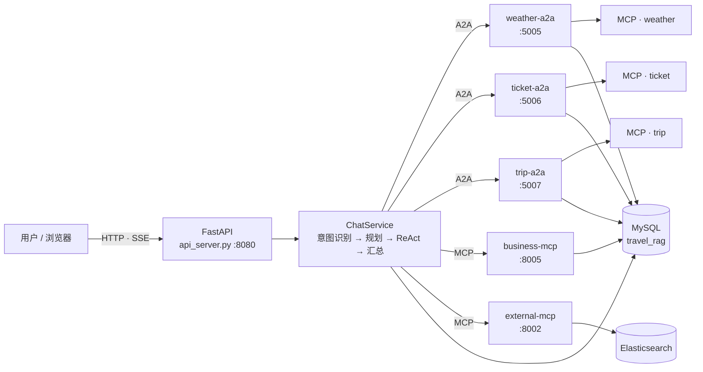
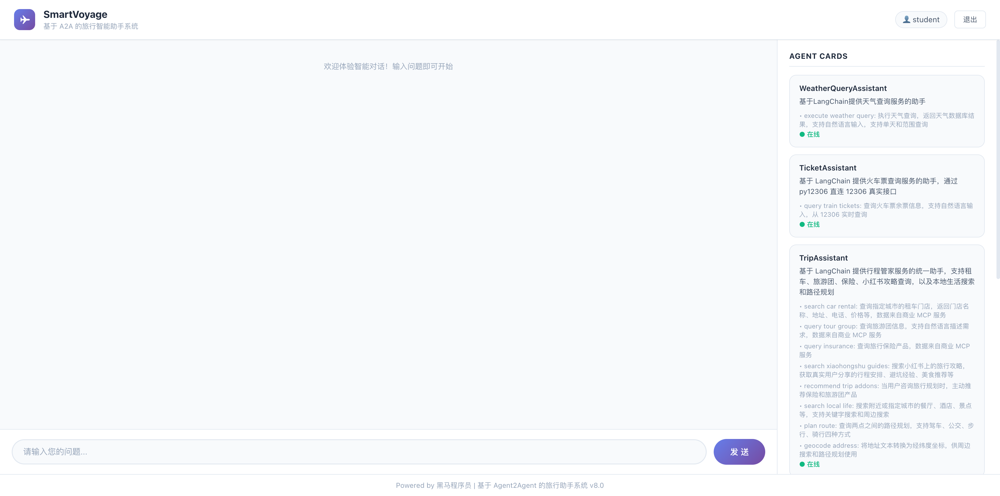
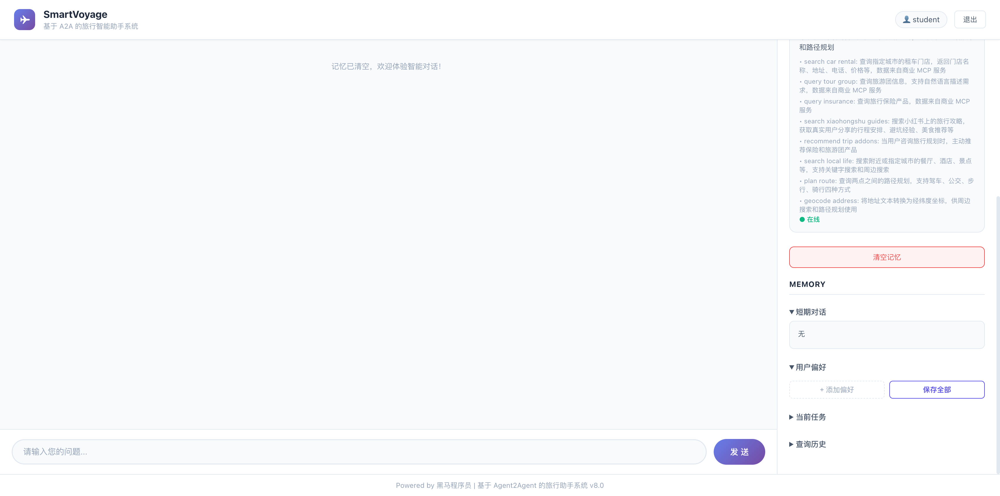
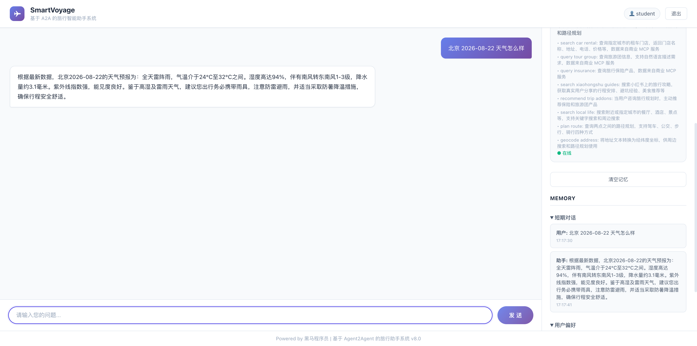
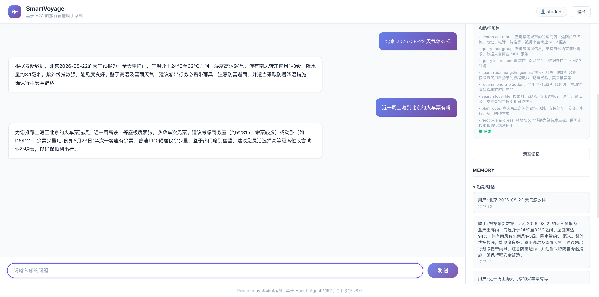
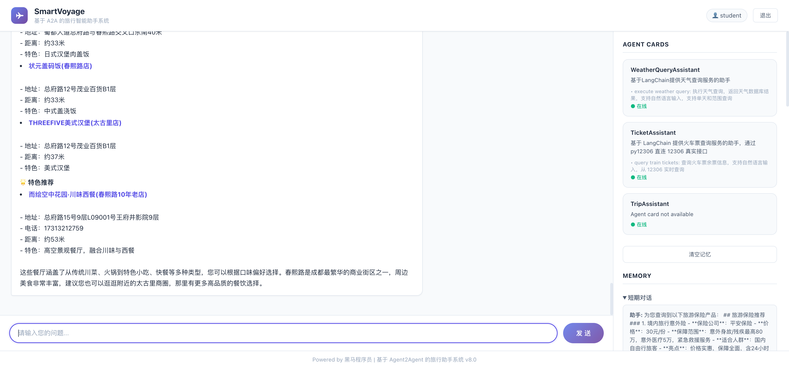
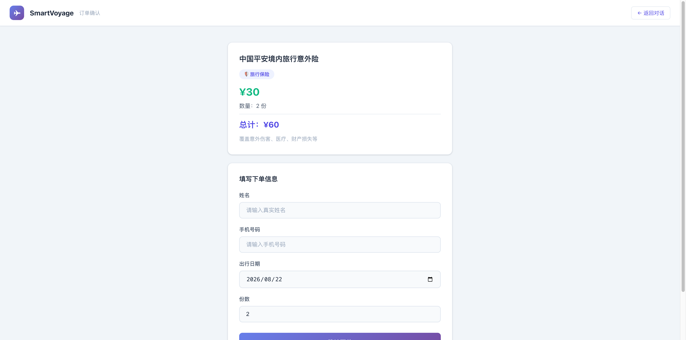

# SmartVoyage · 智能旅游助手

> 基于 **多智能体（Multi-Agent）+ MCP + A2A** 架构的旅游出行智能助手：一次对话，完成查天气、订机票火车票、租车、跟团游、买保险、找本地生活和做旅游攻略。


## 项目简介

SmartVoyage 面向「旅游出行」垂直场景，把分散在多个第三方服务里的能力（天气、票务、租车、跟团游、保险、本地生活、旅游攻略）统一到一个对话入口。系统不依赖单个大模型硬扛所有逻辑，而是用**多智能体协作**把任务拆开：

- **意图识别**：用轻量模型判断用户想做什么，可同时识别多个意图；
- **任务规划**：多意图且存在依赖时，生成执行计划；
- **ReAct 执行**：按计划逐步调用对应子代理，记录 Observation；
- **结果汇总**：把多步结果整合成一条连贯回复。

每个子代理既可以是 **A2A** 服务，也可以是 **MCP** 服务，便于独立开发、独立部署、独立扩缩容。

## 功能特性

| 能力 | 说明 |
| --- | --- |
| 天气查询 | 和风天气 30 天预报，支持全国城市 |
| 火车票 / 机票 | 车次、余票、航班动态查询 |
| 租车 / 跟团游 / 保险 | 结构化商品卡片 + 下单页跳转 |
| 本地生活 | 高德地图 8 类 POI 工具（美食、酒店、景点等） |
| 旅游攻略 | 博查联网搜索；未配置 Key 时自动降级为教学样例数据 |
| 多轮记忆 | 短期对话、长期偏好、当前任务上下文，MySQL 持久化，服务重启不丢 |
| 流式输出 | SSE 流式对话，边生成边返回 |
| 用户体系 | JWT 登录鉴权，支持用户信息与偏好接口 |
| 一键部署 | Docker Compose 拉起 MySQL / Elasticsearch / MCP / A2A / API 全套服务 |

## 系统架构



一次典型请求的链路：`用户输入 → 意图识别 → （多意图时）任务规划 → 逐个子代理执行 → 结果汇总 → 流式返回`。

## 目录结构

```text
SmartVoyage/
├── api_server.py          # FastAPI 后端：登录、对话、记忆、代理信息、静态页
├── chat_service.py        # 核心对话服务：意图识别 / 任务规划 / ReAct 循环 / 结果汇总
├── memory.py              # 记忆管理：短期对话、用户偏好、任务上下文（MySQL 持久化）
├── main.py                # 命令行交互入口（多轮对话 / 代理卡片 / 记忆查看）
├── main_prompts.py        # 全部 Prompt 模板集中管理
├── config.py              # 配置加载：环境变量 > config.yaml > 兜底默认值
├── config.yaml            # 项目配置文件（密钥留空，请在 .env 中填写）
├── create_logger.py       # 日志初始化
├── init_project.py        # 建表 + 连接检查 + 配置自检
├── a2a_server/            # A2A 子代理：天气 / 票务 / 行程，以及 A2A 客户端
├── mcp_server/            # MCP 服务：业务 MCP + 外部 MCP + 各领域工具
├── services/              # 第三方服务封装：天气、车次、航班、本地生活、联网搜索
├── sql/                   # 建表语句、业务账号授权、测试数据
├── static/                # 原生 HTML/JS 前端与界面截图
├── tests/                 # A2A / MCP 服务连通性测试
├── Dockerfile
├── docker-compose.yml
└── requirements.txt
```

## 技术栈

- **语言 / 运行时**：Python 3.11+
- **Web 框架**：FastAPI + Uvicorn（REST + SSE）
- **智能体编排**：LangChain 1.x、LangGraph
- **协议**：A2A（`python-a2a`）、MCP（`fastmcp` / `mcp`）
- **存储**：MySQL 8（业务数据与记忆）、Elasticsearch 8（检索）
- **前端**：原生 HTML / CSS / JavaScript
- **部署**：Docker Compose

## 快速开始

### 1. 准备配置

```bash
cp .env.example .env
```

打开 `.env`，至少填写大模型配置（兼容任意 OpenAI 协议服务）：

```ini
LLM_BASE_URL=https://api.deepseek.com/v1
LLM_API_KEY=你的密钥
LLM_MODEL=deepseek-chat
```

第三方能力按需填写，不填时对应功能会降级或不可用：

| 变量 | 用途 | 申请地址 |
| --- | --- | --- |
| `HEFENG_API_KEY` | 和风天气 30 天预报 | https://dev.qweather.com/ |
| `AMAP_API_KEY` | 高德地图本地生活工具 | https://lbs.amap.com/ |
| `BOCHA_API_KEY` | 博查联网搜索（旅游攻略） | https://open.bochaai.com |
| `VARIFLIGHT_API_KEY` | 飞常准航班查询 MCP | https://mcp.variflight.com/ |

### 2. Docker Compose 一键启动

```bash
docker compose up -d --build
```

首次启动会拉起 MySQL、Elasticsearch、business-mcp、external-mcp、三个 A2A 子代理和 API 服务。

### 3. 本地开发

```bash
python -m venv .venv && source .venv/bin/activate   # Windows: .venv\Scripts\activate
pip install -r requirements.txt
python init_project.py       # 建表 + 检查数据库连接与配置
python api_server.py         # 启动 HTTP 服务
# 或者只用命令行交互
python main.py
```

### 4. 访问

浏览器打开 <http://localhost:8080>，注册/登录后即可对话。

## 服务端口

| 服务 | 端口 | 说明 |
| --- | --- | --- |
| api-server | 8080 | FastAPI 后端 + 前端页面 |
| business-mcp | 8005 | 业务数据 MCP（订单、商品等） |
| external-mcp | 8002 | 外部能力 MCP 聚合 |
| weather-a2a | 5005 | 天气子代理 |
| ticket-a2a | 5006 | 票务子代理 |
| trip-a2a | 5007 | 行程子代理 |
| mysql | 3306 | 业务数据与记忆 |
| es | 9200 | Elasticsearch |

## 主要接口

| 方法 | 路径 | 说明 |
| --- | --- | --- |
| POST | `/api/login` | 登录，返回 JWT |
| GET | `/api/user/info` | 当前用户信息 |
| POST | `/api/logout` | 退出登录 |
| POST | `/api/chat` | 普通对话 |
| POST | `/api/chat/stream` | 流式对话（SSE） |
| GET | `/api/memory` | 查看记忆状态 |
| POST | `/api/memory/clear` | 清空记忆 |
| POST | `/api/memory/profile` | 更新用户偏好 |
| GET | `/api/agents` | 获取全部代理卡片 |

需要鉴权的接口通过 `Authorization: Bearer <token>` 传递 JWT。

## 界面预览

| 登录页 | 主界面 |
| --- | --- |
|  |  |

| 天气查询 | 机票查询 |
| --- | --- |
|  |  |

| 本地生活 | 订单页 |
| --- | --- |
|  |  |

## 测试

```bash
pytest tests -v
```

`tests/test_mcp_servers.py` 与 `tests/test_agent_servers.py` 用于检查各 MCP / A2A 子服务的连通性，需先启动对应服务。

## 说明

- **仓库内不含任何真实密钥**：`config.yaml` 与 `.env.example` 中的密钥字段均为空，请在本地 `.env` 中填写，`.env` 已被 `.gitignore` 忽略。
- 配置优先级：**环境变量 > `config.yaml` > 代码兜底默认值**，由 `config.py` 统一管理。
- 本项目为学习/实践项目整理，第三方接口的可用性与配额以各服务商为准。
